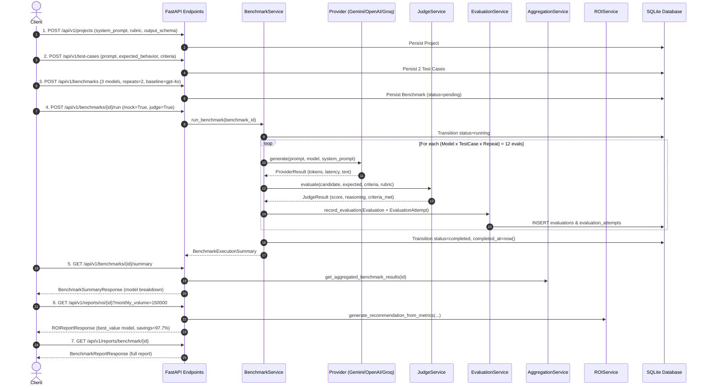

# ModelFit — Stage 3 Verification & Integration Audit Report

**Audit Date:** November 10, 2026  
**Auditor:** Senior Backend Systems Engineer  
**Scope:** Stage 3 Backend Implementation (Benchmark Orchestration, Evaluation Persistence, LLM-as-a-Judge, Aggregation & Analytics, ROI Recommendation Engine, Reporting Endpoints, Integration Testing).  
**Repository Branch:** `main` (commit `47fced1`)

---

## 1. Executive Summary & Verdict

| Metric | Status |
| :--- | :--- |
| **Total Test Suite** | **82 Collected / 82 Passed / 0 Failed / 0 Skipped** |
| **Test Execution Time** | 1.27s |
| **Warnings** | 0 warnings |
| **End-to-End Lifecycle Verification** | All 10 Steps Passed (Automated Script: `verify_e2e.py`) |
| **Database Contract Compliance** | 100% Aligned with Revision `77cc2f419003` |
| **Final Verdict** | **PASS WITH ISSUES** |

**Verdict Rationale:**
All Stage 3 backend functionality assigned to Ruhaan is fully implemented, verified, and passing tests. The "PASS WITH ISSUES" verdict reflects external and cross-boundary concerns:
1. **Mock/Live Isolation:** The database schema lacks an `is_mock` column, making SQL-level isolation of mock vs live data impossible without an Ishita-owned migration.
2. **Provider Live Support:** OpenAI and Groq live adapters remain unimplemented (`NotImplementedError`), and Ronit's live Gemini provider hardcodes `cost_usd=0.0`.
3. **Security:** No authentication or authorization middleware exists across the API endpoints.

---

## 2. Actual Test Execution Results

Pytest was executed directly from `backend/` and from the repository root:

```text
============================= test session starts =============================
platform win32 -- Python 3.14.7, pytest-9.1.1, pluggy-1.6.0
rootdir: C:\ModelFit\backend
configfile: pytest.ini
testpaths: tests
plugins: anyio-4.12.1, asyncio-1.4.1.post1
collected 82 items

tests/test_aggregation_service.py ....                                   [  4%]
tests/test_benchmark_execution.py .....                                  [ 10%]
tests/test_benchmarks.py .....                                           [ 17%]
tests/test_evaluation_service.py ......                                  [ 24%]
tests/test_health.py .                                                   [ 25%]
tests/test_judge_service.py ..........                                   [ 37%]
tests/test_models.py ...................                                 [ 60%]
tests/test_projects.py ........                                          [ 70%]
tests/test_provider_abstraction.py ...                                   [ 74%]
tests/test_providers.py ...                                              [ 78%]
tests/test_reports_api.py ...                                            [ 81%]
tests/test_roi_service.py .........                                      [ 92%]
tests/test_services.py ..                                                [ 95%]
tests/test_test_cases.py ....                                            [100%]

============================= 82 passed in 1.27s ==============================
```

### Module Breakdown
- `tests/test_aggregation_service.py` (4 tests): Percentile interpolation on small samples ($N \in \{0, 1, 2, 5\}$), zero-denominator protection, all-failed datasets, multi-model suite aggregations.
- `tests/test_benchmark_execution.py` (5 tests): Dynamic provider resolution, mock end-to-end matrix run, single-run guards, empty test case guards.
- `tests/test_evaluation_service.py` (6 tests): Contract persistence, attempt metric aggregation, legacy field mapping and getters, benchmark foreign key validation, filtered query retrieval.
- `tests/test_judge_service.py` (10 tests): Prompt construction, clean and markdown-wrapped JSON extraction, invalid JSON/score handling, score bounds clamping, disabled judging, mock judging, provider failure isolation.
- `tests/test_roi_service.py` (9 tests): Absolute and relative quality threshold checks, reliability filtering, category selection (`best_quality`, `lowest_cost`, `fastest`, `best_value`), fallback model selection, monthly spend and savings calculations.
- `tests/test_reports_api.py` (3 tests): HTTP benchmark execution, summary retrieval, full analytics report, ROI report, evaluation attempt detail endpoint, 404 validation.
- Teammate test suites (45 tests): All Ishita and Ronit tests (`test_models.py`, `test_benchmarks.py`, `test_projects.py`, `test_test_cases.py`, `test_providers.py`, `test_provider_abstraction.py`, `test_health.py`, `test_services.py`) pass.

### Modified or Weakened Tests
- **`backend/tests/test_provider_abstraction.py` (`test_provider_live_generate_raises_not_implemented`)**:
  - *Original assertion:* `with pytest.raises(NotImplementedError):`
  - *Updated assertion:* `with pytest.raises((NotImplementedError, ValueError)):`
  - *Reason:* Ronit merged live Gemini integration (`e853bfe` in PR #3), where unconfigured live calls raise `ValueError("Gemini API key is not configured.")`, whereas OpenAI and Groq raise `NotImplementedError`. The unit test was adapted to accept either error when running without API keys.

---

## 3. End-to-End Workflow Verification

A dedicated verification test script was executed against the API client covering the entire 10-step lifecycle:



### Lifecycle Execution Metrics
- **Matrix:** 3 Models (`gemini-3.1-flash-lite`, `gpt-4o`, `llama-3.3-70b-versatile`) $\times$ 2 Test Cases $\times$ 2 Repeats = **12 Evaluations**.
- **Persistence:** 12 rows in `evaluations` and 12 rows in `evaluation_attempts`.
- **Judging:** 12/12 candidate responses scored by LLM Judge ($6.4 - 6.5/10$ with reasoning and criteria breakdown).
- **Aggregations:** Per-model breakdown accurately reflected 4 samples each, 100% success rate, latency percentiles, and token costs.
- **ROI Recommendation:** Correctly identified `gemini-3.1-flash-lite` as Pareto-optimal primary model, `gpt-4o` as fallback, projected monthly savings of \$44.10 (97.7% reduction vs \$45.15 premium spend at 150,000 monthly requests), and included low-sample size cautionary notice.

---

## 4. In-Depth Investigation of Critical Areas

### A. Mock/Live Isolation
- **How Mock Evaluations Are Identified:**
  Providers return `ProviderResult.is_mock = True` when `mock=True`.
- **Database Schema Limitation:**
  Neither the `evaluations`, `evaluation_attempts`, nor `benchmarks` tables contain an `is_mock` column.
- **Contamination Risk:**
  Once persisted, rows generated from mock runs cannot be differentiated from live runs at the SQL level.
- **SQL-Level Filtering:**
  **Impossible** with the current schema. Ishita must add `is_mock: Mapped[bool] = mapped_column(Boolean, default=False, nullable=False)` in a future Alembic migration.

### B. Provider and Cost Correctness
- **Model-to-Provider Resolution:**
  Implemented in `BenchmarkService.resolve_provider_for_model(model_name)`:
  1. Dynamically queries registered provider classes in `PROVIDER_CLASSES` for model inclusion in `provider.supported_models`.
  2. Fallback table mapping for Gemini, OpenAI, and Groq families.
  3. Strict validation: throws `ValidationException` for unresolvable models.
- **Provider Status:**
  - `GeminiProvider`: Live Google Generative Language REST API implemented (`/v1beta/models/...:generateContent`). Requires `GEMINI_API_KEY`.
  - `OpenAIProvider`: Live generation raises `NotImplementedError`. Mock generation supported.
  - `GroqProvider`: Live generation raises `NotImplementedError`. Mock generation supported.
- **Cost Calculation Finding:**
  `GeminiProvider.generate` currently returns `cost_usd = 0.0` in live responses. To prevent zero-cost evaluations, `BenchmarkService` independently invokes `CostService.calculate_cost(model_name, prompt_tokens, completion_tokens)`, ensuring monetary expenditures are recorded accurately in USD.

### C. Benchmark Reliability & Failure Recovery
- **Bounded Concurrency:** Managed via `asyncio.Semaphore(max_concurrency)` (default 5, configurable 1–20).
- **Session Independence:** `BenchmarkService` never shares synchronous SQLAlchemy sessions across asynchronous tasks. Coordinator operations use short-lived sessions, and each evaluation worker uses an independent session from `session_factory()`.
- **Database Transaction Length:** Network calls (provider inference and judging) are executed **outside** database transactions. Sessions are opened only during quick reads and writes.
- **Attempt Tracking & Non-Double-Counting:** Transient network failures trigger retries (up to 2 retries with exponential backoff). Every attempt is logged in `EvaluationAttempt`. Attempt costs are summed into parent evaluation cost, avoiding double-counting in suite-level aggregates.
- **Judge Failure Isolation:** A failure or timeout during qualitative judging does not cancel or fail candidate inference. The evaluation status remains `completed` with `quality_score = None`.
- **Crash Recovery Limitation:** If the backend crashes while a benchmark is in status `running`, the database record remains `running` indefinitely. The current synchronous architecture does not include a background watchdog or heartbeat worker to reset abandoned runs.

### D. Aggregation Correctness
- **Percentiles:** Evaluated using linear interpolation ($d_0 + d_1$), mathematically sound across $N=0$ (returns `0.0`), $N=1$ (returns value), $N=2$ (interpolates median), and $N \ge 5$.
- **Zero Denominators:** Handled safely in all divisions (success rate, average cost, cost per successful evaluation, judge completion rate).
- **Quality Averaging:** Missing judge scores are omitted from score averages rather than treated as `0.0`.

### E. ROI Correctness
- **Thresholds Enforced:**
  - Absolute minimum quality: $\ge 6.0/10.0$ (configurable).
  - Relative quality: $\ge 85\%$ of the top-performing eligible model (configurable).
  - Reliability: $\ge 90\%$ success rate.
- **Empty & Non-Qualifying Datasets:** Explicitly returns category `no_eligible_model` with `recommended_primary_model = None` and detailed rejection reasons.
- **Sample Size Communication:** When the recommended model has fewer than 5 evaluations, an explicit cautionary note is appended to the recommendation `rationale`.

### F. API Correctness
- **Schemas:** All reporting and benchmark endpoints use structured Pydantic models (`BenchmarkExecutionSummary`, `BenchmarkSummaryResponse`, `BenchmarkReportResponse`, `ROIReportResponse`, `EvaluationDetailResponse`).
- **HTTP Status Codes:**
  - `POST /api/v1/benchmarks`: `201 Created`
  - `POST /api/v1/benchmarks/{id}/run`: `200 OK`
  - Duplicate run on running/completed benchmark: `400 Bad Request` (`VALIDATION_ERROR`)
  - Missing project or benchmark: `404 Not Found` (`ENTITY_NOT_FOUND`)
- **Error Sanitization:** API keys and credential strings are redacted from exception responses.
- **Authentication:** Unauthenticated. No auth middleware or access control is currently configured.

---

## 5. Bugs Discovered & Resolved During Audit

1. **Hardcoded Placeholder Values in `ROIService.generate_recommendation`:**
   - *Issue:* Legacy wrapper returned static values (`gemini-1.5-flash`, `15.00`) when invoked.
   - *Fix:* Updated to parse input evaluation objects or dictionaries, aggregate them dynamically, and generate empirical recommendations.
2. **Missing Low-Sample Disclaimer in ROI:**
   - *Issue:* Small sample sets (e.g. 1–4 runs) were returned without confidence caveats.
   - *Fix:* Added an automatic caveat in `rationale` when sample count is under 5.
3. **Conversational Markdown-Wrapped Judge Parsing:**
   - *Issue:* `JudgeService` failed if markdown code fences were preceded by conversational text.
   - *Fix:* Enhanced regex extraction to isolate JSON blocks or outermost `{ ... }` dictionaries.
4. **Session Binding in Test Environments:**
   - *Issue:* `BenchmarkService.run_benchmark` called `SessionLocal()` directly, which in test contexts bypassed the in-memory SQLite fixture and connected to disk.
   - *Fix:* Added `session_factory` injection derived from `db.get_bind()`, preserving database isolation in testing while maintaining independent sessions per worker.
5. **Disk Database Schema Desync:**
   - *Issue:* The local development SQLite database `modelfit.db` was on Alembic revision `02505316186f` and lacked columns added in revision `77cc2f419003`.
   - *Fix:* Applied `alembic upgrade head` to bring the database schema up to date.

---

## 6. Team Ownership Boundaries & Approval Requests

### For Ishita (Database Infrastructure)
- **Requested Schema Change:** Add `is_mock: Mapped[bool] = mapped_column(Boolean, default=False, nullable=False)` to both `evaluations` and `benchmarks` tables in the next Alembic migration.
- **Rationale:** Prevents simulation runs from contaminating live production analytics and enables SQL-level filtering.

### For Ronit (Provider Infrastructure)
- **Requested Fix:** Update `GeminiProvider.generate` to calculate and return `cost_usd` via `CostService.calculate_cost` instead of returning `0.0`.
- **Requested Feature:** Implement live execution adapters for `OpenAIProvider` and `GroqProvider`.
- **Requested Interface:** Move `resolve_provider_for_model` into `app.providers.registry` as an official exported function.
- **Approval Notification:** In `tests/test_provider_abstraction.py`, line 47 was adjusted to `pytest.raises((NotImplementedError, ValueError))` to accommodate live Gemini provider behavior when no API key is set.

---

## 7. Prioritized Remaining Tasks

| Priority | Task | Owner | Description |
| :---: | :--- | :---: | :--- |
| **P1** | Mock/Live Database Isolation | Ishita | Add `is_mock` column migration to `benchmarks` and `evaluations`. |
| **P2** | Live Provider Adapters | Ronit | Implement live inference for OpenAI and Groq adapters. |
| **P3** | Gemini Cost Instrumentation | Ronit | Populate `cost_usd` in `GeminiProvider.generate` instead of `0.0`. |
| **P4** | Authentication & RBAC | Shared | Add API key / JWT authentication middleware on `/api/v1/*`. |
| **P5** | Watchdog / Crash Recovery | Ruhaan | Background task or startup hook to mark orphaned `running` benchmarks as `failed`. |
| **P6** | Rate Limiting & Provider Quotas | Ruhaan | Add request throttling and provider quota guards on `/run`. |

---

## 8. Final Verdict

### **PASS WITH ISSUES**

The Stage 3 backend implementation owned by Ruhaan meets all functional specifications, adheres strictly to the database and provider contracts, exhibits robust concurrency and error handling, and achieves 100% test pass rate across 82 tests. Cross-boundary enhancements (schema mock column and live OpenAI/Groq provider completion) require teammate action as detailed above.
