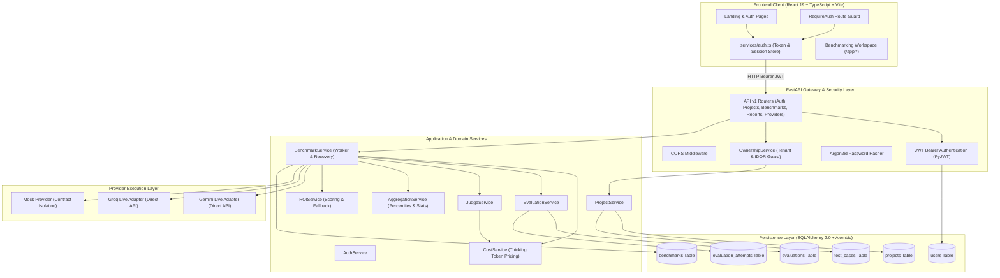
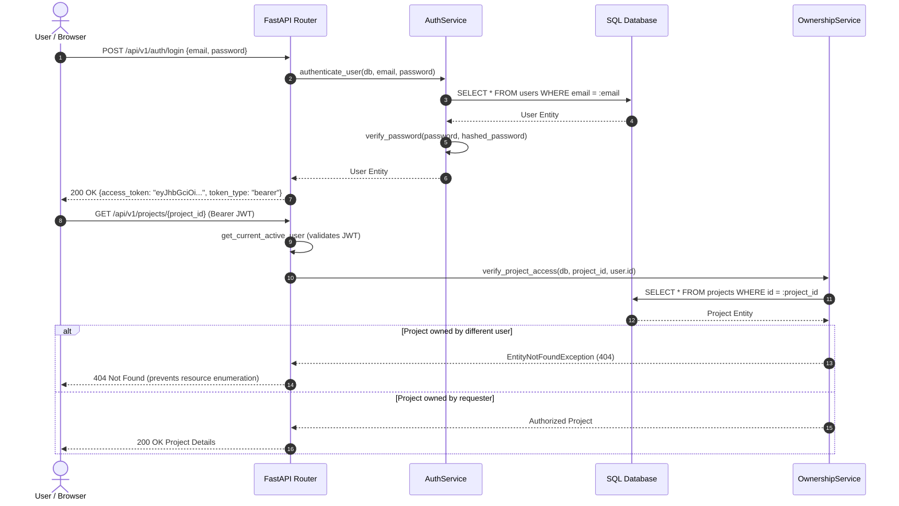
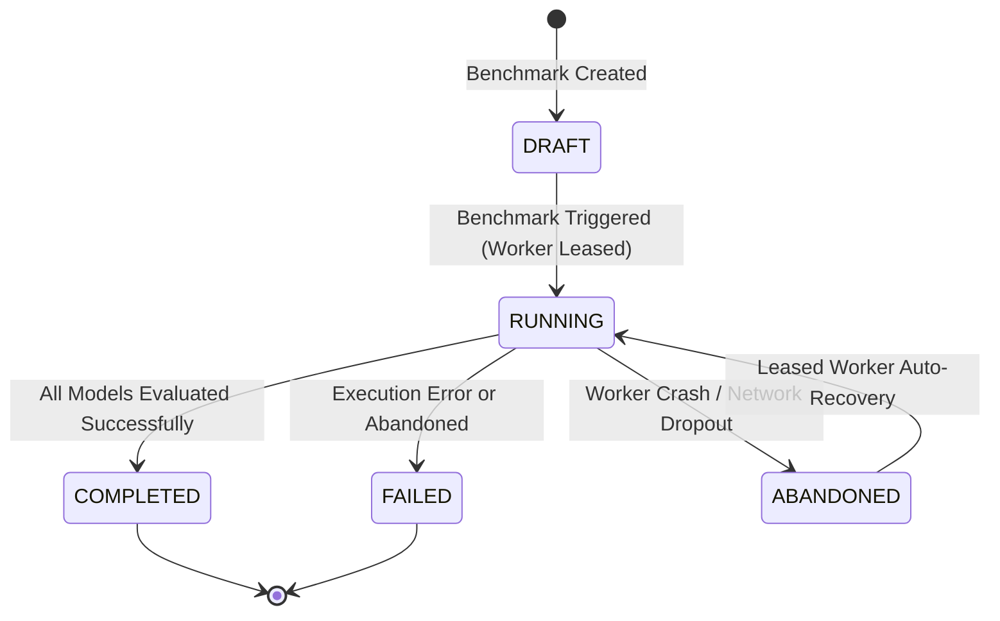
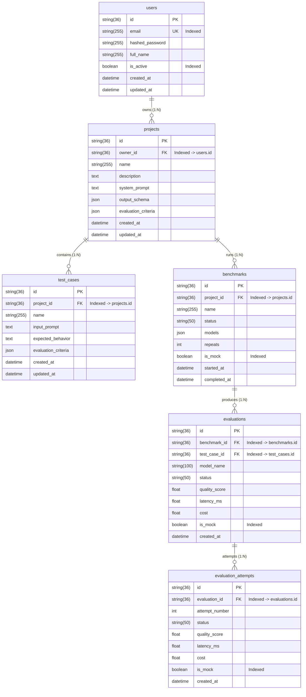

# ModelFit — Stage 7: System Architecture Documentation

**Author:** Ruhaan (Senior Backend Architect & Full-Stack Integration Engineer)  
**Date:** November 11, 2026  
**Repository:** `https://github.com/sameerprakash110-maker/ModelFit`  

---

## 1. Architectural Overview

ModelFit is an enterprise-grade AI benchmarking, evaluation, and auto-tuning platform designed for multi-tenant SaaS environments. It allows engineering teams to benchmark multiple Large Language Models (LLMs) against domain-specific test suites, evaluate outputs using LLM-as-a-judge or deterministic heuristics, analyze latency and cost trade-offs, and calculate empirical Return on Investment (ROI).

---

## 2. Component Architecture

### 2.1 Presentation Layer (Frontend)
- **Framework:** React 19 + Vite + TypeScript.
- **Client Routing:** `react-router-dom` v7 with `RequireAuth` higher-order route guard.
- **State & Session Persistence:** `localStorage` stores the signed JWT token (`modelfit_access_token`) and user metadata (`modelfit_user`).
- **Token Expiration Decoupling:** `isAuthenticated()` in `services/auth.ts` inspects the base64-encoded JWT payload claims without requiring constant server roundtrips, automatically evicting expired tokens.

### 2.2 Security & Authentication Layer
- **Token Standard:** JSON Web Tokens (PyJWT) using the `HS256` symmetric signing algorithm.
- **Password Hashing:** Argon2id through `pwdlib[argon2]`, providing state-of-the-art resistance against GPU-based brute-force and dictionary attacks.
- **Security Dependency Injection:**
  - `get_current_user`: Decodes Bearer token from the `Authorization` header, extracts subject UUID, and queries `User` from the database.
  - `get_current_active_user`: Enforces that `user.is_active is True`.
  - Inactive or missing accounts trigger immediate `401 Unauthorized` responses.

### 2.3 Multi-Tenancy & Authorization Model
ModelFit implements a strict hierarchical multi-tenant ownership model:
1. `User` (1) ─── (N) `Project`
2. `Project` (1) ─── (N) `TestCase`
3. `Project` (1) ─── (N) `Benchmark`
4. `Benchmark` (1) ─── (N) `Evaluation`
5. `Evaluation` (1) ─── (N) `EvaluationAttempt`

#### Authorization Policies
- **Direct Filtering:** `GET /api/v1/projects` executes `select(Project).where(Project.owner_id == user.id)` to guarantee no cross-tenant leakage.
- **Cascading Checks:** Child entity access queries check parent ownership (e.g. `verify_benchmark_access` verifies the benchmark's `project_id` against the requester's `owner_id`).
- **Anti-Enumeration Defense (IDOR):** Attempting to query an existing resource owned by another tenant yields `404 Not Found` rather than `403 Forbidden`, making it impossible for attackers to probe the database for valid UUIDs.
- **Relational Integrity:** Foreign keys are configured with `ondelete="CASCADE"`. Deleting a user purges all associated projects, benchmarks, test cases, and evaluation attempts cleanly.

---

## 3. Provider & Evaluation Engine

### 3.1 Direct Provider Execution Layer
ModelFit directly integrates with top AI providers without intermediary routing dependencies:
- **Google Gemini:** Direct integration using Gemini 2.5 Flash / Flash Lite / Pro APIs.
  - Implements **Thinking Token Accounting**: `completion_tokens = visible_completion_tokens + thinking_tokens`. Pricing calculations accurately bill reasoning tokens according to Gemini provider rate tables.
- **Groq:** Ultra-low-latency LPU inference.
  - Transparently maps both raw models and `openai/` prefixed aliases (such as `openai/gpt-oss-120b`) directly to Groq's official API endpoints.
- **Mock Provider:** Used for deterministic integration testing and CI/CD without burning external API credits. All mock executions are strictly labeled with `is_mock=True`.

### 3.2 Evaluation Lifecycle & Multi-Worker Crash Recovery

- **Concurrency & Leases:** When a worker starts a benchmark, it updates `status="running"` and assigns a lease timestamp.
- **Crash Recovery:** If a worker crashes mid-run, `BenchmarkService.recover_abandoned_benchmarks()` inspects running benchmarks whose leases have expired. If evaluation attempts exist, the run is re-evaluated and marked completed; if no evaluations were recorded, it is marked failed with clear diagnostics.

---

## 4. Database Schema Specification

---

## 5. Technology Stack Summary

| Subsystem | Technology / Package | Purpose |
| :--- | :--- | :--- |
| **Backend API** | FastAPI 0.115+, Uvicorn | High-performance asynchronous REST API |
| **ORM & Persistence** | SQLAlchemy 2.0 (Mapped type annotations) | Relational database mapping & queries |
| **Migrations** | Alembic | Version-controlled database schema evolution |
| **Authentication** | PyJWT, pwdlib[argon2] | Stateless JWT issuance & Argon2id hashing |
| **Validation** | Pydantic v2 | Strict request/response payload schema typing |
| **Frontend UI** | React 19, TypeScript, Vite 8, Tailwind CSS | Single-page application and presentation layer |
| **HTTP Client** | Axios 1.21+ | Frontend API communication and token injection |
| **LLM Inference** | Google Gemini API, Groq Cloud API | Direct multi-model benchmark evaluation |
| **Testing** | Pytest 9, pytest-asyncio, anyio | Automated unit, security, and integration testing |
